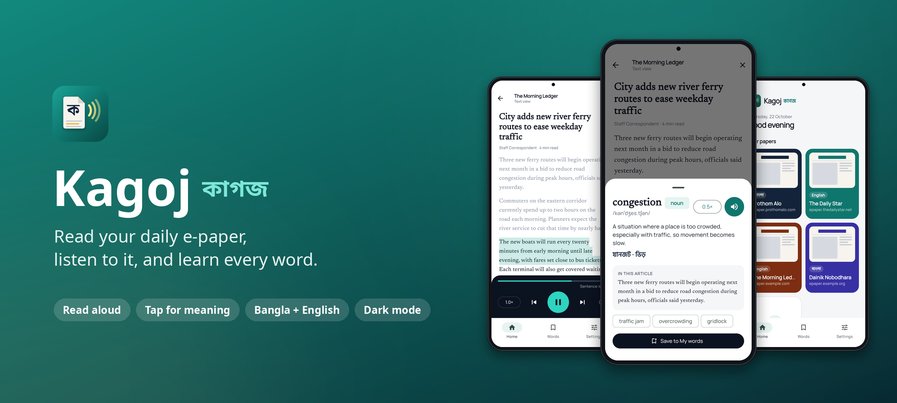
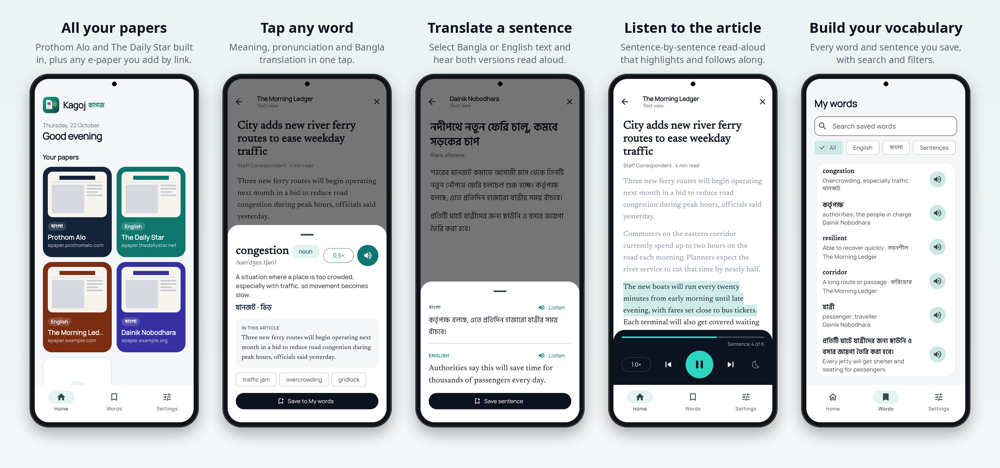
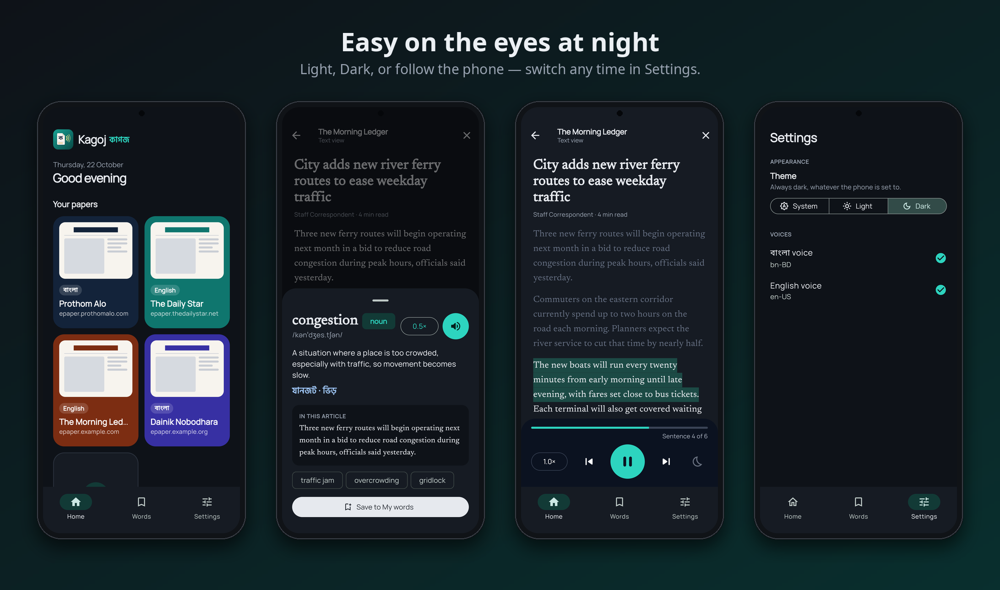
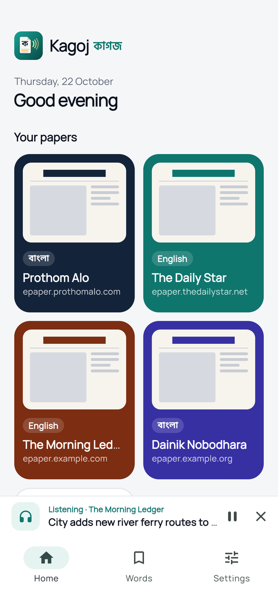
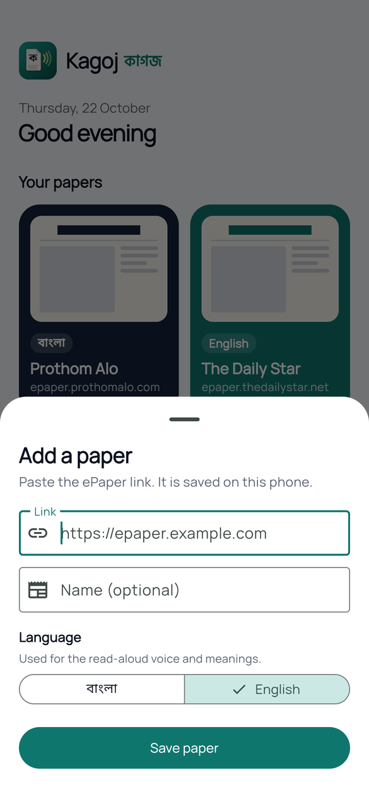
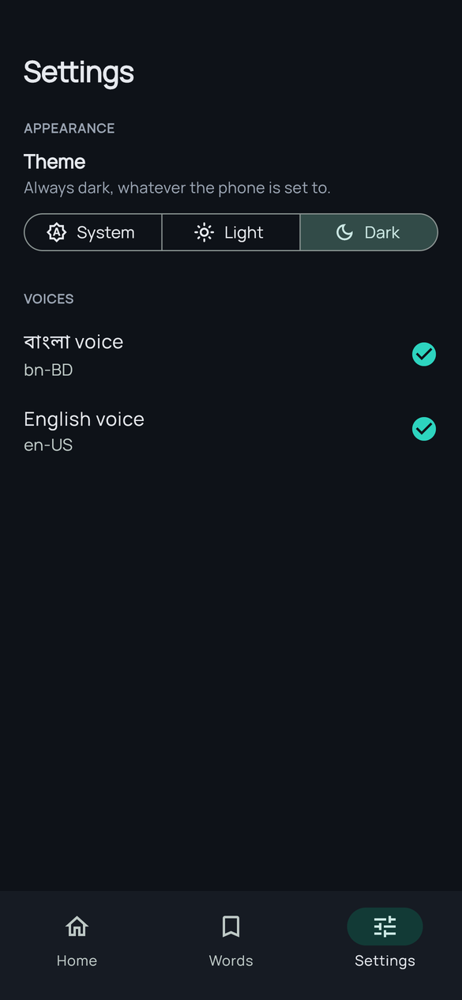
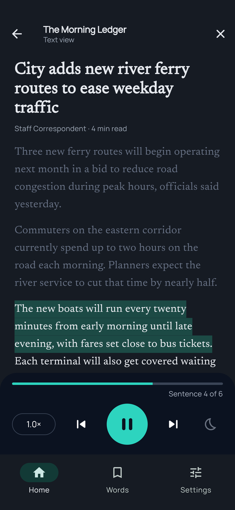
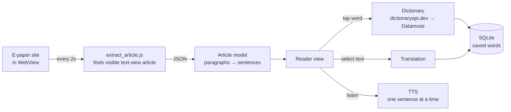

<p align="center">
  
</p>

<h1 align="center">Kagoj · কাগজ</h1>

<p align="center">
  <b>A calm, focused e-paper reader for Bangla and English newspapers:<br>
  read in a clean reader view, have articles read aloud, and tap any word to learn it.</b>
</p>

<p align="center">
  
  
  
  
  
</p>

---

Kagoj (*kagoj* is Bangla for “paper”) opens the e-paper you already read inside the app.
When an article is open in the site's **text view**, Kagoj lifts it into its own reader. There you can:

- 🔊 **Listen** to the article, sentence by sentence, with the current sentence highlighted.
- 👆 **Tap any word** for its meaning, pronunciation and Bangla translation.
- 🌐 **Select a sentence** to translate between Bangla and English and hear both versions.
- 🔖 **Save** words and sentences to build your own vocabulary list.

It comes with **Prothom Alo** and **The Daily Star**, and you can add any other e-paper by pasting its link.

## Screenshots

<p align="center">
  
</p>

<p align="center">
  
</p>

<details>
<summary><b>More screens</b></summary>
<br>

| Now reading bar | Add a paper by link | Settings (dark) | Listen (dark) |
|:---:|:---:|:---:|:---:|
|  |  |  |  |

</details>

> The screenshots use fictional sample papers (*The Morning Ledger*, *Dainik Nobodhara*) and sample text written for this README. No newspaper content is reproduced.

## Features

| | |
|---|---|
| **📰 Your papers, one tap away** | Prothom Alo and The Daily Star are built in. Add any other e-paper by link, with a name and language; it's saved on the phone. Long-press a paper to edit or remove it. |
| **📖 Reader view** | Articles open in a clean reader with newspaper typography (*Newsreader* for English, *Hind Siliguri* for Bangla). |
| **📌 Now reading** | Leave the reader and the article stays docked above the navigation bar on every tab, with play/pause while listening. Tap to jump back; it only goes when you press ✕ or open another article. |
| **🔊 Read aloud** | Uses the phone's text-to-speech in `bn-BD` or `en-US`. Reads one sentence at a time, highlighting and scrolling as it goes. Speed control and previous/next sentence. |
| **👆 Tap for meaning** | Part of speech, IPA pronunciation, definition, similar words and the sentence the word came from. Play the pronunciation at normal or 0.5× speed. |
| **🌐 Translate** | Select text → *Translate* → original and translation side by side, each with its own *Listen* button. |
| **🔖 My words** | Saved words and sentences with search and filters (English, বাংলা, Sentences). |
| **🌙 Light / Dark / System** | A full dark palette, not just a dark background. The choice is applied before the first frame, so there's no white flash. |
| **🛡️ Resilient by design** | The dictionary falls back from [dictionaryapi.dev](https://dictionaryapi.dev) to [Datamuse](https://www.datamuse.com/api/) when one is down. If a page fails to load, you see the reason and a *Try again* button, not a blank screen. |

## How it works



1. **Browse:** the real site loads in [`flutter_inappwebview`](https://pub.dev/packages/flutter_inappwebview), so you sign in once and the cookies persist.
2. **Detect:** every two seconds, [`assets/js/extract_article.js`](assets/js/extract_article.js) looks for a *visible* article. It uses per-paper CSS selectors, or a generic rule (the largest visible block of `<p>` text) when none are set. When it finds one, an **Open in reader** button appears.
3. **Read:** the article is split into sentences, handling `.` `!` `?` and the Bangla *dari* `।`. Every word becomes tappable, and every sentence can be read aloud on its own.

## Tech stack

| Concern | Choice |
|---|---|
| UI | Flutter 3.47, Material 3, `google_fonts` |
| State | `flutter_riverpod` (Notifier / FutureProvider) |
| Navigation | `go_router` with a `StatefulShellRoute`, so the bottom bar stays on every screen |
| Web content | `flutter_inappwebview` with injected JavaScript |
| Speech | `flutter_tts` (device voices), `just_audio` (recorded pronunciations) |
| Network | `dio` |
| Storage | `sqflite` (papers, saved words), `shared_preferences` (settings) |

## Project structure

```
lib/
├── core/
│   ├── data/          SQLite database, shared preferences
│   ├── models/        Paper + built-in papers
│   ├── router/        go_router setup
│   └── theme/         Light & dark palettes (ThemeExtension), typography
├── features/
│   ├── home/          Paper grid + add-paper tile
│   ├── papers/        Saved papers repository, add/edit sheet
│   ├── epaper/        WebView browser + article detection
│   ├── reader/        Article model, extractor, reader UI, meaning & translation sheets
│   ├── listen/        TTS service, listen controller, player panel
│   ├── dictionary/    Dictionary (with fallback), translation interface, pronunciation
│   ├── words/         Saved words
│   └── settings/      Theme mode, voice availability
├── shared/widgets/    App shell with the bottom navigation bar
└── demo/              Demo entry point used for the README screenshots
assets/js/             Script injected into the e-paper WebView
tool/                  Logo generator, screenshot pipeline
```

## Getting started

### Requirements
- Flutter 3.47+ (Dart 3.13+)
- Android SDK 36, JDK 17
- An Android phone or emulator (Android 5.0+)

### Run
```bash
git clone https://github.com/Al-Mahamud/kagoj.git
cd kagoj
flutter pub get
flutter run
```

To have articles read aloud in Bangla, install the Bangla voice on the phone: **Settings → Text-to-speech → Google → Install voice data → Bangla (Bangladesh)**. *Settings* inside Kagoj shows whether each voice is installed.

### Build a release APK
```bash
cp android/key.properties.example android/key.properties   # then fill in your keystore
flutter build apk --release --split-per-abi
```
`app-arm64-v8a-release.apk` (~27 MB) fits almost every modern phone. Without `key.properties`, release builds fall back to the debug key.

### Test
```bash
flutter analyze
flutter test
```
The tests cover:
- splitting English and Bangla text into sentences
- the dictionary fallback, simulating a real outage (HTTP 530) with no network calls
- saving and restoring the theme choice
- the "Now reading" bar staying across tabs, being replaced by a new article, and closing with ✕

## Notes

<details>
<summary><b>Why the app bundles one certificate for The Daily Star</b></summary>
<br>

`profile.thedailystar.net`, the Daily Star login page, doesn't send its intermediate TLS certificate.
Desktop browsers fetch the missing certificate themselves, but Android WebView doesn't, so the login page fails with an SSL error.
[`network_security_config.xml`](android/app/src/main/res/xml/network_security_config.xml) supplies that public intermediate (*Sectigo Public Server Authentication CA OV R36*) for `thedailystar.net` only.
The chain is still fully verified against the system's trusted roots, and nothing is bypassed.
</details>

<details>
<summary><b>Regenerating the logo and screenshots</b></summary>
<br>

- **Logo and launcher icons:** `python3 tool/generate_logo.py .` draws them in code, including the adaptive and Android 13 themed icons.
- **Screenshots:** `tool/screenshots/run.sh` does three steps:
  1. builds [`lib/demo/main_demo.dart`](lib/demo/main_demo.dart) for the web; this runs the real screens with sample data
  2. captures each screen in headless Chrome at 390×844 @3×
  3. frames and captions the shots with [`compose.py`](tool/screenshots/compose.py)
</details>

## Roadmap

- [ ] Site-specific selectors for each paper's text view (the generic rule is used for now)
- [ ] Bangla ↔ English translation provider; the interface is in place, so sentence and Bangla-word lookups are the remaining piece
- [ ] Sleep timer, background playback and lock-screen controls
- [ ] Reader text size and sepia theme
- [ ] Daily review flashcards for saved words
- [ ] Continue-listening card and word of the day on the home screen

## Disclaimer

Kagoj isn't affiliated with, or endorsed by, Prothom Alo, The Daily Star or any other publisher.
It displays each publisher's own website inside the app, for personal reading with your own account. It doesn't copy, store or redistribute newspaper content.
All newspaper names and trademarks belong to their owners.

---

<p align="center">
  Built by <a href="https://github.com/Al-Mahamud">Al-Mahamud</a> with Flutter.
</p>
